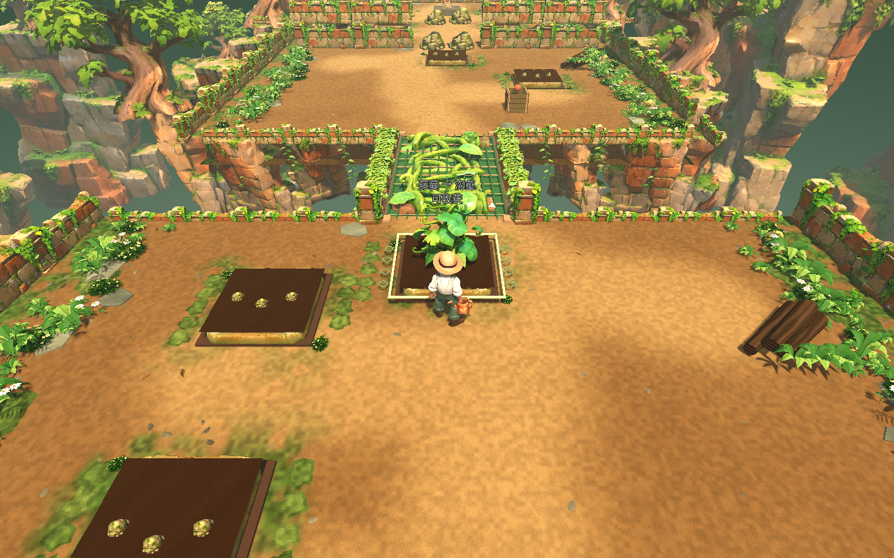
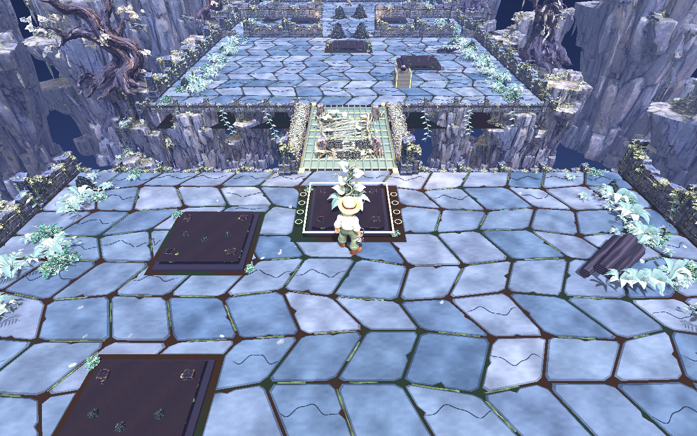

# 苏醒园地 · Awakening Garden

两套可独立打开、运行和继续编辑的 Godot 完整工程：

| 工程 | 美术主题 | 工程入口 | 工程说明 |
| --- | --- | --- | --- |
| **A1 · 陶土暖园** | 暖色陶土庭园 | [`A1/project.godot`](A1/project.godot) | [A1 使用说明](A1/README.md) |
| **D1 · 月下荆园** | 月下荆棘庭园 | [`D1/project.godot`](D1/project.godot) | [D1 使用说明](D1/README.md) |

每套工程均包含玩法脚本、场景、完整分辨率模型与纹理、农民角色及骨骼动画、中文字体和原有验证资料。两套工程互不依赖，运行时无需 API Key 或外部网络服务。

## 实机预览

### A1 · 陶土暖园



### D1 · 月下荆园



## 获取完整工程

- **直接下载**：前往本仓库的 **Releases**，下载 `A1-complete-project.zip` 或 `D1-complete-project.zip`。两个文件保留原始交付内容，可分别下载使用。
- **继续开发**：克隆本仓库，分别导入 `A1/project.godot` 或 `D1/project.godot`。
- **校验下载**：Release 随附 `SHA256SUMS.txt`；文件大小与 SHA-256 也记录在 [`archives-manifest.json`](archives-manifest.json) 中。

原始 ZIP 作为 Release 附件保存；仓库目录保存解压后的可编辑工程。

GitHub 下载附件使用英文文件名，并配有中文标签。`A1-complete-project.zip` 对应原始的 `A1-完整工程.zip`，`D1-complete-project.zip` 对应 `D1-完整工程.zip`；仅下载名称不同，文件内容与 SHA-256 完全一致。

## 打开与运行

1. 安装 Godot。工程原始交付资料记录的验证版本为 **4.7.2.stable**。
2. 在 Godot 项目管理器中导入所需风格的 `project.godot`。
3. 等待首次模型、纹理和字体导入完成，按 **F5** 运行。

场景美术会在运行时通过脚本组装。编辑器未运行时可能显示基础灰盒，运行后加载完整场景。

| 操作 | 按键 |
| --- | --- |
| 移动 / 加速 | WASD / Shift |
| 开垦、播种、浇水、收获 | E |
| 推进时间 | T |
| 切换种子 | 1 / 2 |
| 旋转 / 缩放镜头 | 按住右键拖动 / 滚轮 |
| 暂停 / 重开 / 返回安全位置 | Esc / R / H |

## 目录

```text
.
├── A1/                       # 陶土暖园完整 Godot 工程
├── D1/                       # 月下荆园完整 Godot 工程
├── README.md                 # 总览与下载指引
├── ARCHIVE-NOTES.md          # 整理方式与原始资料说明
├── archives-manifest.json    # 原始交付包大小、SHA-256
└── SHA256SUMS.txt            # 下载校验清单
```

两个工程均保留各自的 `art/`、`scripts/`、`fonts/`、`docs/`、`tests/` 和 `tools/`。各文件夹的用途详见各自 README。

## 修改与验证

在对应工程目录运行：

```sh
python tools/update_asset_hashes.py --apply
python tools/validate_project.py --godot "你的 Godot 控制台程序路径"
```

第一条命令用于替换已登记模型后更新资产校验值。第二条命令运行工程自带检查；可追加 `--headless`。这些检查由原始工程提供，本次归档整理未重新执行游戏运行或美术验收。

## 资源与许可

字体许可证分别见 [`A1/fonts/OFL.txt`](A1/fonts/OFL.txt) 与 [`D1/fonts/OFL.txt`](D1/fonts/OFL.txt)。本次整理保留原始资产来源资料，未为整个工程额外授予开源许可证；各资源的使用条件以原始授权为准。
